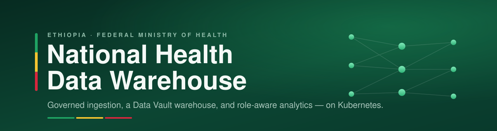

<div align="center">



<br>

-326CE5?logo=kubernetes&logoColor=white)


</div>

A reference implementation of Ethiopia's **National Health Data Warehouse** — replicas of
the national source systems, a governed ingestion and dbt pipeline that builds a Data
Vault and analytical marts, an access-controlled API gateway, and a set of role-aware
dashboards. The whole system runs on Kubernetes and comes up from a single script.

The design goal is honesty end to end: only the *source* systems are ever seeded. Every
tier above them — the lake, the warehouse, the marts, the dashboards — is populated by the
real pipeline, so what you see in a dashboard genuinely travelled through ingestion,
transformation and access control to get there.

---

## How it fits together

```
  Source systems           Ingestion            Warehouse              Access
  ─────────────────       ───────────         ───────────────       ─────────────
  DHIS2 · EthioEMR         dlt-style           object lake            API gateway
  HCMIS · mBrana    ─▶     ingestors    ─▶     → ClickHouse    ─▶     (OPA row-level   ─▶   5 dashboards
  MFR · IDSR               + bridge            → Data Vault           authorization)        + analyst tools
                                               → dbt marts (bi_*)
```

- **Sources** — containerised replicas of the systems a national warehouse draws from
  (aggregate HMIS, an EMR, logistics/supply, the facility registry, disease surveillance).
- **Pipeline** — ingestors land raw records into an object lake; a bridge moves them into
  ClickHouse; dbt builds a Data Vault and the subject-area `bi_*` marts that serve the UI.
- **Access** — Keycloak proves identity; OPA decides what each role may read and returns a
  row filter the gateway applies before the query runs. The dashboards are catalogue-driven:
  a page is a set of widgets, each declaring the mart it reads.

## Documentation

| Guide | What's inside |
|-------|---------------|
| [Architecture](docs/architecture.md) | The system end to end — sources, ingestion, lake, warehouse, gateway, dashboards. |
| [Deployment & operations](docs/deployment.md) | Running, rebuilding, tearing down and packing the system; what ships and what doesn't; observability. |
| [Security & identity](docs/security.md) | Keycloak realms and the Fayda flow, OPA authorization and row filtering, single sign-on to the tools. |
| [Data, dashboards & ML](docs/data-and-ml.md) | The `bi_*` marts, the five dashboards and the widget model, and the machine-learning layer. |
| [Data dictionary](docs/data-dictionary.md) | Generated catalogue of every programme, indicator, commodity, region and mart. |

## Quick start

Requires Docker and [k3d](https://k3d.io). One script builds the cluster, loads or builds
the images, applies the manifests, seeds the sources and runs the pipeline:

```bash
./bootstrap.sh                    # full bring-up
./bootstrap.sh --rebuild-images   # rebuild the service images from source first
./bootstrap.sh teardown           # remove the cluster, keep the source volumes
./bootstrap.sh teardown --wipe-sources   # factory reset, including source data
```

When it finishes, the dashboards are served at their `*.127.0.0.1.nip.io` hosts. Sign in
through Keycloak with any of the seeded demo users — a data analyst, a regional bureau
officer scoped to one region, a programme decision-maker, a data scientist, a security
officer — and watch the same page show different data, or refuse it, depending on who is
looking. The public portal needs no login.

## Repository layout

```
0_external/        source-system replicas + restore scripts
1_infrastructure/  Kubernetes manifests (kustomize) — the declarative definition
2_pipelines/       dbt projects (staging → vault → marts) + the lake→warehouse bridge
3_storage/         Postgres, ClickHouse, SeaweedFS (object store), Trino — schemas and init
6_access-points/   the API gateway + the five dashboard SPAs + tool gateway
7_security/        Keycloak, OPA, OpenBao — identity, policy, secrets
bundle/            everything that brings the system up from zero: scripts, seeds, docs
docs/              developer documentation
```

## What's not included

To keep the repository lightweight, the large artifacts are left out and reconstituted on
first run:

- **Container images** rebuild from source with `./bootstrap.sh --rebuild-images`.
- **Binaries and drivers** (helm, `mc`, and similar) download on first run.
- **Source seed data** is the one thing the pipeline can't reconstruct on its own — without
  it the source systems start empty. Supply the dumps under each
  `0_external/sources/*/sample-data/` folder (each has a short notice describing the expected
  files) to populate a full demo.

## Secrets

No real secret material lives in the repository. Templates carry placeholder tokens and a
generator fills them with fresh values per deployment into a gitignored secrets file.
