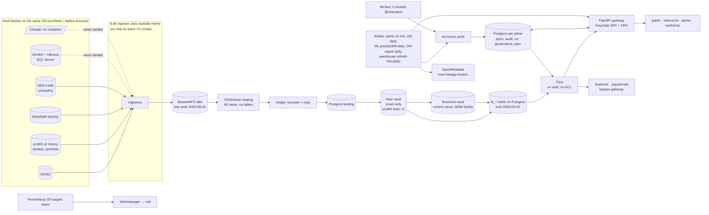

# B. System and product coverage map

Part of the [release-readiness pack](README.md). This page describes the system **as built and as running**, measured
on 2026-10-20/21 against the live cluster, and compared with the repository at `develop` 92ede8e. Where the earlier
diagrams in `docs/architecture.md` disagree with this page, this page is the measured one (see RR-402).

Status vocabulary used throughout:

| Code | Meaning |
|---|---|
| **RV** | Runtime-verified: observed working today |
| **C** | Connected: deployed and wired, but its function was not exercised end to end |
| **PW** | Partially working |
| **I** | Implemented in the repo, not running |
| **X** | Intentionally excluded or not deployed |
| **U** | Unverified |

## 1. As-built architecture

**What the diagram means for a customer.**
- The platform is a complete *pipeline shape*: lake → staging → vault → marts → policy-enforced API → dashboards.
- But it ran **once**, on 2026-09-22, over synthetic and demo source data.
- Nothing refreshes it, nothing backs it up, and nothing alerts when it fails (RR-101, RR-102, RR-103).

**Deployed vs repository.**

| Layer | Matches `develop` 92ede8e? |
|---|---|
| Kubernetes manifests (Helm release `nhdw` rev 7) | Yes |
| Image contents (every custom image tagged `1.0.0`) | **No** (RR-004) |

The image contents are a 2026-09-21 20:31 build, plus gateway code not in git. Some deployments were edited by hand:
the gateway deployment is at revision 66. The PCT eLMIS fix `c83f0f9` exists only on a local branch.

## 2. Component inventory

| # | Component | Purpose | Where it lives | Depends on → consumers | Config / environment assumptions | Status | Tests / evidence | Gap → effect | Findings |
|---|---|---|---|---|---|---|---|---|---|
| 1 | Source replicas | Stand-in source systems | `0_external/sources/*`, `bundle/scripts/sources-up.sh` | host Docker → ingestors | Same VM; reached via a CoreDNS host alias | PW | 6 healthy, MFR unhealthy, no climate container | No real feed; 4 lanes empty | RR-301, RR-302 |
| 2 | Ingestors (8, dlt) | Source → lake (parquet + manifest) | `2_pipelines/ingestor/*`, `1_infrastructure/k8s/base/ingestor-jobs.yaml` | sources → `nhdw-raw` | Not in Helm; images remapped by kustomize | PW | Lake holds 4 of 8 lanes; Job logs gone (TTL) | No schedule; no schema contract | RR-101, RR-108 |
| 3 | SeaweedFS | Object lake, exports, static datasets, docs | Helm `templates/seaweedfs*`, `3_storage/seaweedfs` | ingestors, ClickHouse, gateway, OM | Legacy `minio-*` secret names | RV | Filer listing; init Job complete | Single volume, no replication; `nhdw-backups` empty; anonymous ListBuckets | RR-102, RR-207 |
| 4 | ClickHouse 24.3 | Staging engine (s3 views + dbt staging) | Helm, `2_pipelines/staging` | lake → bridge | Named collections secret | RV | `raw_*` counts = lake | Metrics target down; MFR views error | RR-103 |
| 5 | Bridge | ClickHouse staging → Postgres landing | `2_pipelines/vault/bridge/sync.py` | CH → landing | Truncate/drop + full copy | C | Landing = CH for every landed lane | Not incremental; silent schema re-create | RR-108 |
| 6 | Raw vault (dbt + AutomateDV) | Hubs, links, satellites | `2_pipelines/vault/models` | landing → BV, marts | Full-refresh only when empty | RV | Job complete 2026-09-22; ~553 tests | eLMIS links doubled | RR-002 |
| 7 | Business vault | Current views, conformed hubs, MDM facility | `2_pipelines/vault/models/business*` | raw vault → marts | — | RV | Current views = hub counts (except eLMIS) | Commodity/date conformance empty | RR-107 |
| 8 | Marts (dbt) | `bi_*` analytical tables | `2_pipelines/marts/models` (58 models) | vault → Trino, gateway, publish | Postgres only | PW | ~154 generic + 5 singular tests; they did not catch ×4 or the missing DQ mart | 9 empty, 2 missing; 28 days stale | RR-002, RR-012, RR-101 |
| 9 | Public dataset publish | CSV + catalogue for the open-data page | `2_pipelines/marts/publish_public_datasets.py` | `bi_public` → `nhdw-static` | k-anonymity by dbt test only | PW | CSVs written 2026-09-22; **catalogue manifest missing** | Fabricated catalogue shown | RR-007, RR-303 |
| 10 | Postgres 16 | Vault, marts, ops, and all tool metadata DBs | Helm STS, `3_storage/postgres/init` | everything | One instance, 10 Gi local-path, 8.5 GB used | RV | All queries in this assessment | SPOF; never backed up; destructive init SQL in CI path | RR-102, RR-209 |
| 11 | Trino 476 | SQL façade (gateway, Superset, notebooks) | Helm, `3_storage/trino/etc` | PG vault + ops | No authentication, no access control | RV | Gateway queries succeed | Bypass of policy; patient-level synthetic view readable | RR-203 |
| 12 | Gateway (FastAPI) | API, authn/z, masking, audit | `6_access-points/api/nhdw-gateway` | Trino, ops DB, OPA, Keycloak, MLflow, SeaweedFS | `GATEWAY_PUBLIC_ANON=true`, `GATEWAY_DEMO_IMPERSONATION=true`, profile hostPath | RV | Masking 17/17, import 201 routes; 7 days: 3,062 allow / 102 deny / 34 5xx | Anonymous audit log; 36/112 GETs anonymous; JWT alg from token | RR-001, RR-207, RR-208 |
| 13 | OPA 1.5.0 | Policy decisions | `7_security/opa/policies` (14 role files) | ← gateway | Fail-closed | RV | 29/29 tests; live = repo | Only gateway traffic is governed | RR-203 |
| 14 | Keycloak | Identity (3 realms + master) | `7_security/keycloak` | → gateway, gates, tools | `start-dev`; reseed needs live host-base envs | RV | 11 persona logins succeed | Shared committed password; no MFA; admin console public | RR-201, RR-205 |
| 15 | Tool gates (5) | OIDC front for Prometheus, Alertmanager, Headlamp, MLflow, SeaweedFS | `6_access-points/api/tool-gate` | Keycloak | One image from a non-existent registry | PW | SSO verified for each | No role check (researcher gets MLflow) | RR-214, RR-212 |
| 16 | Public portal | Anonymous public statistics | `6_access-points/dashboards/public` | gateway via allow-listed proxy | Profile copy deck | PW | Walked anon; data = mart exactly | Fabricated fallbacks; fake catalogue; mock news; placeholders | RR-006–008, RR-011, RR-015 |
| 17 | Internal BI | Staff analytics + Control Tower | `6_access-points/dashboards/internal-bi` | gateway `/gw` proxy | Catalogue spec per role | PW | Walked with 7 personas | Stale image; Control Tower unreachable; zeros for missing data; 401s | RR-004, RR-005, RR-010, RR-025 |
| 18 | Admin console | Operations, governance, docs | `6_access-points/dashboards/admin` | gateway | — | PW | 11/11 pages walked | DQ page empty; super-admin over-denied; placeholder IdPs | RR-012, RR-028, RR-026 |
| 19 | Workshop | Researcher portal | `6_access-points/dashboards/workshop` | gateway | — | C | 6/6 pages walked | Datasets empty | — |
| 20 | Superset | Self-service BI | `6_access-points/dashboards/superset` | Trino directly | Bypasses OPA/audit | C | SSO walked | Consumer roles get SQL Lab | RR-203, RR-214 |
| 21 | JupyterHub | Notebooks | `6_access-points/jupyterhub` | Keycloak, Trino | Notebook pods get `TRINO_HOST` | C | SSO walked | Bypass `[hyp]` | RR-203 |
| 22 | dbt-docs | Model documentation | Helm, PVC | — | — | RV | SSO walked | Content from 2026-09-22 | — |
| 23 | Airflow 2.10 | Orchestration | `5_orchestrator/dags` (6 DAGs) | KPO pods, gateway | DAG default images point at a non-existent registry, overridden by env | PW | 2 DAGs failing nightly; refresh paused | No failure callbacks | RR-020, RR-022, RR-101 |
| 24 | MLflow | Model registry | Helm, `3_storage/model-registry` | ops DB → ml-runner | — | RV | 5 models @champion (2026-09-22) | Forecast champion trained on ×4 data | RR-003 |
| 25 | ml-runner | Train, predict, drift | `2_pipelines/ml/runner`, `bundle/seed-pack/app/ml` | MLflow, marts → `ops_ml` | Default alias `champion` | PW | 5/6 models predict daily | Promotion ungated; predictions not reaching marts | RR-003, RR-101 |
| 26 | MDM matcher | Facility/commodity matching | `2_pipelines/mdm/matcher` | landing/BV → ops governance | Not in Helm | PW | Ran once (28 d ago); 2,234 conformed facilities | Commodity MDM empty; 0 releases | RR-107 |
| 27 | Terminology (`nhdw_ref`) | Concept store | `3_storage/postgres/init/34_ref_vocab.sql`, `bundle/seeds/ref-vocab` | — | — | I (0 rows) | — | Claimed live in docs | RR-107, RR-406 |
| 28 | OpenMetadata 2.0.2 | Catalogue and lineage | Helm, `openmetadata_ingestion` DAG | PG, CH, lake, dbt artifacts | SSO env patched live; repo pins localhost | PW | 82 restarts; DAG "success" | 0 lineage edges into marts | RR-019 |
| 29 | DQ plane | Detect and track DQ incidents | `routes/dq.py`, `38_governance.sql`, `dq_detection` DAG | dbt artifacts → `dq_flag` | — | PW | 5 open flags, 4 weeks old | DQ mart missing; no escalation | RR-012, RR-103 |
| 30 | Monitoring | Metrics, logs, alerts | Helm (Prometheus 2.53, Loki 2.9, Alertmanager 0.27) | — | — | PW | 6/9 targets up | Receiver `null`; dead error-rate rule | RR-103 |
| 31 | Exports & reports | User exports, templates | `routes/exports.py`, `routes/reports.py` | marts → `nhdw-exports` | — | PW | Export download = on-screen rows (893) | Two routes 500 | RR-023 |
| 32 | Plan decisions | Approve/reject + audit | `routes/ct.py`, `42_pct_plan.sql`, init 43 seam | ops DB → `mart_pct_plan_decisions` | Role list hard-coded | C | 1 live decision + audit row; survived restarts | Mutable; no downstream; live write NOT RUN | RR-018, RR-106 |
| 33 | Packaging | Deploy the system | Helm `1_infrastructure/helm/nhdw`, `k8s/base` + overlays, Ansible `site.yml`, `bundle/scripts/*` | — | Two parallel definitions (Helm + kustomize) | PW | Helm rev 7 live | Out-of-git live config | RR-212 |
| 34 | CI/CD | Test and deploy | `.github/workflows/{test,deploy,provision}.yml`, self-hosted runner | — | Hard-coded host + kubeconfig path | PW | Last jobs 2026-09-21 Failed/Failed/Canceled | Not gated; idle; dirty runner checkout | RR-206 |
| 35 | Unmanaged extras | Palladium console, EMR tools | host Docker + hand-made ingresses | — | Not in git | C | Own logins, no SSO | Outside the release boundary | RR-212 |
| — | Not deployed (doc-only) | Grafana, OpenBao, OpenHIM, FHIR server, ArgoCD, CloudBeaver, Kafka | various | — | — | X | No pods | Docs imply they exist | RR-402 |

## 3. Pipelines and freshness

| Pipeline | Schedule | State today | Last success | Retry / idempotent | Quality gate | Alerting | Findings |
|---|---|---|---|---|---|---|---|
| Ingestors ×8 | none (manual) | 4 lanes landed | 2026-09-22 (inferred) | Partly (dlt state, full refresh purges) | none | none | RR-101, RR-301 |
| ch-raw-views / staging / bridge Jobs | none (manual) | — | 2026-09-22 | Bridge yes | ~8 staging tests | none | RR-101 |
| `dbt-vault` Job | none | Complete | 2026-09-22 09:50 | Hubs yes; links keep restatements | ~553 tests | none | RR-002 |
| `dbt-marts` Job | none | — | 2026-09-22 09:57 | Rebuild yes | ~159 tests (did not catch ×4) | none | RR-002, RR-012 |
| `pipeline_refresh` | 02:00 | **Paused, 0 runs** | never | Would false-succeed | none effective | none | RR-020, RR-101 |
| `alert_evaluation` | every 15 min | running | 2026-10-20 23:30 | via gateway | — | in-app only | — |
| `dq_detection` | 06:15 | running | 2026-10-20 06:15 | fingerprint dedup | is the detector | in-app only | RR-103 |
| `ml_batch_predict` | 04:00 | **failing nightly** (1 of 6 tasks) | DAG: 2026-09-22 | delete+insert | — | none | RR-022 |
| `ml_drift_check` | 06:00 | **failing nightly** | DAG: 2026-09-22 | U | — | none | RR-022 |
| `openmetadata_ingestion` | 05:00 | "success" (masks lineage failure) | 2026-10-20 05:03 | OM upsert | — | none | RR-019 |

**Freshness per lane (today, 2026-10-21).**

| Lane | Freshness |
|---|---|
| DHIS2, eLMIS, EthioEMR | Lake 28 days old; data periods end 2026-06 (DHIS2/IDSR) and 2018-08 (eLMIS) |
| MFR organisations | 117 days old |
| HCMIS, mBrana, Climate, MFR facilities | Never loaded |

No surface shows its as-of date (RR-104).

**Hop-by-hop counts.**

| Lane | Source | Lake / CH raw | Landing | Raw vault | Marts | Reconciles? |
|---|---|---|---|---|---|---|
| DHIS2 | — | 701,338 values | 701,338 | 701,338 links/sats | coverage mart 547,965 rows | Yes |
| eLMIS | 2,607,247 lines / 163,453 reqs | 2,607,247 | 2,607,247 | **5,208,578 links (×2); req link 326,317 (×2)** | **Σ dispensed ×3.99** | **No** (RR-002) |
| EthioEMR | 1,500 patients / 13,766 encounters / 98,951 obs | same | same | same | service marts built | Yes |
| HCMIS, mBrana, Climate | — | 0 | 0 | 0 | supply marts 0 rows | n/a (RR-301) |
| MFR | orgs 1,625, devices 4,309, facilities 0 | orgs only | as source | as source | 2 small marts | Partly |

## 4. Dashboard inventory and four-way reconciliation

| Dashboard | Catalogue widgets (live) | Placed on pages | UI components | Nav routes vs catalogue pages | Reachable live (et-v3) | Orphans / breaks |
|---|---|---|---|---|---|---|
| Public | 10 | 10 on 3 pages | 10 | 4 UI pages vs 3 catalogue pages; **the SPA ignores the catalogue** | 6 page widgets (3 `pub-zm-*` disabled) | `pub-zm-*` not in git; `pub-hero` fetcher unused; id drift `pub-articles` |
| Internal BI | 70 | 52 on 7 pages | 66 | 7 = 7 | **48** (Control Tower page disabled; `sv-rr-timeliness` disabled) | 12 unplaced widgets; 1 hard-coded unmounted widget |
| Admin | 11 | 11 on 12 pages | 11 | 11 nav + docs | 11 | `admin/backups` empty page |
| Workshop | 17 | 15 on 6 pages | 17 | 6 | 15 | 2 unplaced |
| Demo | 0 | 4 empty pages | no UI deployed | — | 0 | empty pages |
| **Total** | **104** | **88** | **104** | | | 13 fetchers with no consumer; 8 gateway ops with no UI consumer |

- **Gateway API:** 196 operations (176 paths) live, which match the repo route decorators 1:1. 2 live-only fetchers
  are not in git (RR-004).
- **dbt exposures:** 58, matching the 54 fetcher widgets plus the 4 Control Tower widgets.
- **Under-declared lineage:** `WIDGET_MARTS = {}`, although 11 fetchers read more than one mart (RR-111).

## 5. Metric matrix (every mounted widget)

**Nature codes**

| Code | Meaning |
|---|---|
| OBS | Observed (aggregated from seed/source rows) |
| CALC | Calculated |
| INF | Inferred / rule |
| FC | Model forecast |
| SYN | Synthetic or fabricated |
| STAT | Static |
| PH | Placeholder |

**Live state codes**

| Code | Meaning |
|---|---|
| OK | Reconciles with the mart |
| WRONG | Number shown is incorrect |
| MISLABEL | Number is right but the label is wrong |
| EMPTY | No data shown |
| ZERO-FOR-NULL | Missing data rendered as 0 |
| FAIL | Query errors |
| FAB | Fabricated content shown |

Dates are data-anchored (`max(month)` of the mart), not wall-clock, except where noted. Full per-widget definitions
(numerator, denominator, grain, filters, file:line) are in evidence file C §2.

### 5.1 Public portal (anonymous)

| Widget / metric | Definition (num / den) | Units · grain · period | Lineage (mart → API → widget) | Nature | Live state | States on failure | Findings |
|---|---|---|---|---|---|---|---|
| Hero copy | Profile copy deck | text | host profile → `/api/profile/copy/public` → `pub-hero` | STAT | **Raw placeholders** | n/a | RR-011 |
| KPI tiles ×7 (Penta3, ANC4, SBA, mCPR, TB success, ART VL, U5 stunting) | Σ(rate × facilities reporting) / Σ facilities reporting, by region | % · national × month · latest month 2026-06 (not shown) | DHIS2 → `mart_hmis_indicator_coverage` → `bi_public.mart_public_indicator_kpis` → `pub-insights` | OBS (demo) + CALC | OK vs mart, **but 5 regions / ~67 facilities labelled national**; monthly stunting implausible | **FAB** (EDHS fallback) | RR-015, RR-006 |
| Data confidence tile | PHEM completeness indicator | % · latest month | same | OBS | OK (99.1) | FAB (92%) | RR-006 |
| Readiness strip | % facilities stocked | % · latest | `mart_supply_stockout_public` → `pub-supply` | OBS | Hidden (0 rows), which is honest | hides | RR-301 |
| Coverage by region | region × indicator rate | % · latest month | `pub-region` | OBS | OK, **labelled "all 14 regions", shows 5** | **FAB** (hard-coded 14 bars) | RR-015, RR-006 |
| 24-month trend | coverage indicators by month | % · 24 months | `pub-insights` | OBS | OK (36 months available) | **FAB** (`Math.random`) | RR-006 |
| Open-data catalogue | manifest entries | rows, MB | publish job → `catalogue.json` → `/api/proxy/catalogue` | — | **FAB live** (manifest 404); download dead | FAB | RR-007 |
| Newsroom / articles | top `public_article` rows | text | `ops_governance.public_article` → `/api/proxy/articles` | **SYN** | Seeded mock bulletins attributed to real institutions | bundled mock | RR-008 |
| `/api/series/*` (no consumer) | hard-coded arrays | % | `public/app/main.py` | PH | Served anonymously | always | RR-017 |

### 5.2 Internal BI: Overview

| Widget / metric | Definition | Units · grain · period | Mart(s) | Nature | Live state | Findings |
|---|---|---|---|---|---|---|
| `ov-brief` (5 lines) | Act-first outbreak × stock, active outbreaks, MOS share, reporting rate, weakest cascade | text · national · latest | 5 marts | CALC/INF | Prints "OTHER retains 0.0%"; supply lines dropped | RR-013 |
| `ov-benchmarks` | Facilities, population, regions, woredas | count · timeless | `mart_facility_capacity`, `mart_health_workforce` | OBS | OK (893 / 101.2M / 14 / 619); **fabricated DEFAULTS on error** | RR-017 |
| `ov-reliability-table` | 0.40·coverage + 0.35·completeness + 0.25·readiness | score · region | coverage + supply marts | CALC | **Double-counts the same metric; zero-fills readiness (cap 75)** | RR-009, RR-014f |
| `ov-source-pulse` | Avg completeness per source | % · source | `mart_data_quality` | — | **FAIL 502** (mart missing) | RR-012 |
| `ov-act-first-woredas` | Max alarm probability per woreda, latest model run | prob · woreda · latest ISO week | IDSR + `ops_ml.ml_predictions` | FC + INF | p = 1.000 "Immediate" (overprecise) | RR-021 |
| `ov-trust-completeness` | Reporting woredas ÷ woredas ever seen | % · latest week | `mart_idsr_disease_weekly` | CALC | 100% by construction | RR-014a |
| `ov-trust-mapping` | Facilities with hierarchy path | % | `mart_facility_capacity` | CALC | 100.0 | — |
| `ov-trust-silent` | Facilities with no HCMIS heartbeat in 60 d (**wall clock**) | count | `mart_facility_capacity` | INF | **WRONG: 893 = 100%** | RR-014c |
| `ov-disease-snapshot` | Σ new cases in the window; diseases with alarm | count · window | IDSR + ML | OBS + FC | **MISLABEL:** "this week" shows 131,432 (weekly 1,976) | RR-014e |

### 5.3 Internal BI: Disease surveillance

| Widget / metric | Definition | Units · grain · period | Mart(s) | Nature | Live state | Findings |
|---|---|---|---|---|---|---|
| KPI strip: active outbreaks | count active (not geo-scoped) | count | `mart_idsr_outbreaks` | INF | 7 | — |
| KPI strip: new cases 7 days (+Δ) | Σ cases at max week vs −7 d | count · ISO week (max 2026-06-29) | `mart_idsr_disease_weekly` | OBS | 1,976 (+9%) OK | — |
| KPI strip: CFR 30 days | Σ deaths / Σ cases, 28 d | % | same | CALC | 1.5 OK | — |
| KPI strip: highest-risk woreda | argmax alarm probability | text + % | + ML | FC | "P(alarm) 100%" (overprecise) | RR-021 |
| KPI strip: reporting completeness / alarm coverage | woreda-weeks ÷ expected; evaluated ÷ in scope | % | same | CALC | 100 / 100 | RR-014a |
| `dz-signal-chart` | Observed vs model mean, 95% CI, threshold | cases · disease × week | ML input + predictions | OBS + FC | 530 rows OK | — |
| `dz-region-map` | Burden /100k, readiness, reliability, p_alarm | per region | 5 marts incl. `mart_data_quality` | OBS + FC | **FAIL 502** (map shape) | RR-012 |
| `dz-woreda-table` | Rank by p_alarm; cases, incidence, CFR | woreda · 12 wk | IDSR + ML + HMIS + supply | OBS + FC | readiness/reliability NULL (key mismatch) | RR-010 |
| `dz-climate-ts` / `dz-climate-corr` | Rainfall/temp vs cases; lag correlation | mm, °C, r | `mart_idsr_climate_drivers` | OBS / missing | **Climate 100% NULL** | RR-301 |
| `dz-outbreaks-table` | Outbreak register | count, % | `mart_idsr_outbreaks` | INF + OBS | 95 rows; 4 NULLs shown as 0 | RR-010 |

### 5.4 Internal BI: Resource management (9 of 11 widgets empty or zero)

| Widget / metric | Definition | Mart(s) | Nature | Live state | Findings |
|---|---|---|---|---|---|
| `rm-hero` | Commodities MOS<3, MOS<1, services exposed | `mart_resource_allocation` (0 rows) | OBS / PH | **ZERO-FOR-NULL** ("0 at risk … 0 stockout") | RR-010, RR-301 |
| `rm-statboard` | Availability, avg MOS, stocked out, wastage | same | OBS | NULL, NULL, **0**, NULL | RR-010 |
| `rm-forecast` | Days to stockout | `mart_supply_stockout_forecast` (0) | FC | EMPTY | RR-301 |
| `rm-wastage`, `rm-map`, `rm-hotspots`, `rm-stock-heatmap`, `rm-events` | Stock and stockout views | supply marts (0) | OBS/CALC | EMPTY | RR-301 |
| `rm-stockout-impact` | days out × service volume | `mart_stockout_service_impact` (0) | CALC | **"No stockouts in the last 12 months"** on an empty mart | RR-010 |
| `rm-act-week` | Outbreak × countermeasure stock | `mart_supply_outbreak_response` | INF | All `no_stock_data`, still ranked | RR-014f |
| `rm-cold-chain` | Excursions, AEFI, affected batches | `mart_epi_cold_chain_safety` | OBS / PH | Batches NULL shown as 0 | RR-010 |

### 5.5 Internal BI: Supply Control Tower (PCT)

The page is **unreachable for every role under the live profile** (RR-005). The API still serves. The time anchor is
consistent: KPI month 2018-08 and plan period 2018-09, both data-anchored.

| Widget / metric | Definition | Units · grain · period | Lineage | Nature | Live state | Findings |
|---|---|---|---|---|---|---|
| Needs covered | covered ÷ at-risk needs | % · movement · Sep 2018 | eLMIS → vault (**×2 links**) → `mart_pct_demand_month` → `mart_pct_position` → `mart_ct_movements` → `/api/ct/plan` | CALC | **WRONG** (inflated inputs) | RR-002 |
| Units to ship / deliveries | Σ units; count legs | units | `mart_ct_movements` | CALC (max-min policy on P50 or AMC) | **11,081,832 / 18,239** (correct-data AMC plan ≈2.78M) | RR-002, RR-003 |
| Delivery runs / facilities served | sweep runs; stops | count | `mart_ct_vehicle_runs` | CALC (sweep, straight-line) | 108 / 2,806; labelled "Optimized" | RR-021 |
| Facilities at risk | distinct facilities with stock < P90 | count | `mart_ct_movements` | INF | 2,749 of 2,806 | RR-002 |
| On-shelf availability | Σnum/Σden pooled | % · Aug 2018 (not shown) | `mart_pct_kpi` | CALC | 99.7 vs hard-coded target 90 | RR-002, RR-104 |
| Stockout exposure / days / within policy | pooled ratios | % · Aug 2018 | `mart_pct_kpi` | CALC | 16.2 / 8.3 / 51.4 (denominators inflated) | RR-002 |
| Movement rail + forecast range | movement, 5-step "why", P10–P90 with run id | units · Sep 2018 | `mart_ct_movements`, `mart_pct_forecast` | CALC + FC | **Forecast range not in the running build; live mart lacks the columns** | RR-004 |
| Approve / reject | Decision + snapshot + audit | per line | `/api/ct/plan/lines/{id}/decide` → `ops_plan.plan_decision` | — | 1 live decision; write test NOT RUN | RR-018 |
| Model performance | — | — | `mart_pct_forecast_accuracy` (no consumer) | — | **Not displayed** (correct while non-citable) | RR-401 |

### 5.6 Internal BI: Service performance

| Widget / metric | Definition | Mart(s) | Nature | Live state | Findings |
|---|---|---|---|---|---|
| Avg coverage | avg `coverage_pct` = **reporting rate** | `mart_hmis_indicator_coverage` | CALC | **MISLABEL** 94.7 | RR-009 |
| Reporting completeness | Σrep/Σexp | same | CALC | 91.1 (differs from other "completeness") | RR-014a |
| Facilities reporting | Σ facilities across 50 indicators | same | CALC | **WRONG** 19,128 vs 893 | RR-014b |
| Indicators tracked | distinct indicators | same | OBS | 50 | — |
| Flagship table | current = reporting rate; status bands | same | CALC | **MISLABEL** all 98.7% "on track"; timeliness NULL → 0% | RR-009, RR-010 |
| Agreement donut | share of cells by agreement band | `mart_reported_vs_recorded` | CALC | **Labels ≠ SQL bands** | RR-014d |
| Data-trust table | biggest disagreements | same | CALC | OK | — |
| Cascades ×4 (HIV, TB, MNCH, NCD) | step ÷ first step | `mart_programme_cascade` | CALC | **EMPTY** (all programme `OTHER`) | RR-013 |
| MNCH continuity / drop-off | fixed `2026-Q1` over a seed table | `bi_programme.mnch_coverage_v` | **STAT/SYN** | Seeded values labelled "EMR-active" | RR-104 |
| Risk woredas | 0.6·(100−coverage)+0.4·(100−completeness) = same metric twice | coverage mart | CALC | degenerate | RR-009 |
| Zero-dose | expected infants (3.2% CBR estimate), Penta1 reach, mBrana stock | `mart_epi_zero_dose` | CALC + INF | mBrana 100% NULL | RR-301 |

### 5.7 Export, settings, admin

All operational, not metrics.
- The export download matches the on-screen rows (893).
- `/api/exports/me` and `/api/reports/templates` return 500 for some principals (RR-023).
- Admin: the DQ page reads `total: 0` (RR-012); Column Governance is empty for super-admin (RR-028); the SSO page shows
  placeholders (RR-026).

### 5.8 Reconciliation verdict

| Scope | Method | Result |
|---|---|---|
| Public (anonymous) endpoints | Curled live and compared with SELECT-only queries | **All matched their marts exactly** |
| Authenticated widgets | Gateway SQL replayed through live Trino, unscoped (the API call itself needed a token) | Numbers equal the mart, but several are **mislabelled or semantically wrong** (§5.2–5.6) |

- **Not exercised:** OPA row filters and masking per persona, beyond the walk's scope checks (§7).
- **Genuine zero vs missing:** the platform conflates them in 128 places (RR-010).
- **Unauthorised:** shows the same message as empty (RR-016).
- **Unavailable service:** shows the same message as empty in BI (RR-016), and fabricated data on the public portal
  (RR-006).

## 6. Route and link matrix

Exercised by headless browser with 11 real persona logins across both staff realms, plus anonymous. Coverage:
**47 of 50 inventoried routes (94%)** and about 150 role × route cells. The 3 routes not walked are BI
`control-tower` (unreachable, RR-005), `predictions` (no navigation entry, not in any spec) and `settings` (reachable
only via the user chip).

**Status key**

| Status | Meaning |
|---|---|
| PASS | Meaningful data, no failed calls |
| PARTIAL | Renders, but with empty widgets, zeros, failed calls or leaks |
| FAIL | Unusable, or wrong for that role |
| NOT RUN | Not exercised |

| App · route | Role(s) | Expected | Observed | Status | Findings |
|---|---|---|---|---|---|
| Public · home | anonymous | Hero, news, insights with data | 16 KPI values, 129 chart marks, 0 failed calls; raw `{platform.native_name}`; title "Federal Ministry of Health · Ethiopia" beside "Palladium" | PARTIAL | RR-011, RR-026 |
| Public · open data | anonymous | Live catalogue, preview, CSV download | Catalogue 404 → fallback datasets; preview static; download `href="#"` | FAIL | RR-007 |
| Public · articles / article | anonymous | Bulletins | Render (seeded mock content) | PASS (render) | RR-008 |
| Public · dashboards modal | anonymous | Login entry points | 3 cards; Internal BI card → login → BI | PASS | — |
| Public · access-request modal | anonymous | Validated form | JS validation; 1 unlabelled input (critical a11y); submit not clicked | PARTIAL | RR-501 |
| BI · Overview | superadmin, analyst, dec.nat | National KPIs | Data present; 401s on profile; 502 source pulse; Region filter "All areas" only; nonsense brief line | PARTIAL | RR-025, RR-012, RR-013 |
| BI · Disease | superadmin, analyst | KPIs, map, charts | Map 502 "No geographic surveillance data"; KPI strip clipped at 1440 | PARTIAL | RR-012, RR-113 |
| BI · Resource | national roles | Supply KPIs, maps | 8/11 KPIs = 0; 6 empty panels | FAIL | RR-010, RR-301 |
| BI · Supply Control Tower | all 11 roles | PCT page | **Not in navigation for any role** | FAIL | RR-005 |
| BI · Service | superadmin | KPIs, cascades | Cascades empty; every indicator `OTHER` 98.7% | PARTIAL | RR-009, RR-013 |
| BI · Export (view) | superadmin, dec.nat | Templates, audit trail | Renders; generate / SQL run not clicked | PASS | — |
| BI · Export download | dec.nat | File = screen | XLSX 893 rows = screen 893 | PASS | — |
| BI · all pages | kebede.oromia (region-scoped) | Locked to region | Region locked to OR; 322 facilities; tamper → 403 | PASS (scope) | — |
| BI · all pages | abebe.bekele (HIV director) | HIV data | **No HIV data anywhere** | FAIL | RR-013 |
| BI · landing | genet.e (low privilege) | Denied cleanly | "No access to Internal BI" + link | PASS | — |
| BI · login | Zambian seed user | Login | Not a Keycloak user | FAIL | RR-005 |
| Admin · Health & topology, Dashboard control, Alert routing, MDM, Models, Users, Roles, Documentation | superadmin, root, hana.d | Live admin data | Render with data | PASS | — |
| Admin · Quality & lineage | superadmin | DQ results | "0/0", "n/a" | PARTIAL | RR-012 |
| Admin · Column governance | superadmin, root | Columns | **403 for R-SUPER**; works for R-OPS-ADM | FAIL | RR-028 |
| Admin · SSO & identity | superadmin | IdP list | `TODO_GOOGLE_CLIENT_ID`, issuer `http://localhost:8096`, "(mock)" | PARTIAL | RR-026 |
| Admin · login | sec.officer | Login | TOTP enrolment required (not completed, by rule) | NOT RUN | — |
| Admin · login | moh-staff user | Rejected | Rejected (realm boundary holds) | PASS | — |
| Workshop · 6 pages | superadmin, genet.e | Portal | Render; datasets empty | PASS | — |
| All SPAs · refresh / back / bookmark | all | Stay on page | **No URL routing**: refresh → first page; back leaves the app | FAIL | RR-112 |
| All BI/admin · 390 px | superadmin | Usable | 332–1,199 px horizontal overflow | FAIL | RR-113 |
| Public · 390 / 1440 px | anonymous | Usable | 0 px overflow | PASS | — |

**Tools and deep links (SSO).**

| Link | From | Expected | Observed | Status | Findings |
|---|---|---|---|---|---|
| dbt-docs | admin / BI | Silent SSO / realm prompt | As designed | PASS | — |
| Airflow | admin, BI | SSO | Extra "Sign in with Keycloak" click; 2 failed DAGs shown | PARTIAL | RR-022 |
| MLflow | admin | SSO | Experiments | PASS | — |
| MLflow, Superset | genet.e (researcher) | Denied | **Full access** (MLflow delete; Superset SQL Lab) | FAIL | RR-214 |
| JupyterHub | admin, BI | SSO → spawn page | As designed | PASS | — |
| Prometheus, Alertmanager, Headlamp, SeaweedFS | admin | SSO gate | Pass | PASS | — |
| OpenMetadata | admin, BI | SSO | Stops at "Sign in with SSO"; spinner on re-visit; completion not verified | PARTIAL | RR-019 |
| Gateway `/docs` | anyone | Restricted | Swagger + OpenAPI served anonymously | FAIL | RR-207 |
| Palladium console, EMR tools | any | SSO | Own logins, no SSO; one 404 | PARTIAL | RR-212 |
| S3 endpoint | anonymous | Denied | ListAllMyBuckets lists `nhdw-static` | PARTIAL | RR-207 |
| Return to origin tab | all | Still signed in | Yes | PASS | — |

## 7. Critical workflow coverage

| Workflow | What was verified | Result | Findings |
|---|---|---|---|
| Login | 11 personas, two realms | PASS (shared password, RR-201) | RR-201 |
| Logout | Keycloak session ends; re-open requires login | PASS (extra confirm page) | — |
| Token after logout | Old bearer still accepted until expiry | PARTIAL | RR-215 |
| Token lifetime / renewal | Access token 1,800 s, never refreshed. After 31 min idle, navigation gives 7 failed calls and "No data for the selected filters" instead of a sign-in prompt; a reload asks for the password | FAIL | RR-016, RR-215 |
| Role switching | Not supported (one primary role) | N/A | — |
| Region scope | Region user sees only its region; tamper → 403 | PASS | — |
| Programme scope | HIV director sees no HIV data; `/ct/plan` not programme-scoped | FAIL | RR-013, RR-027 |
| Restricted pages / APIs for low privilege | 403 everywhere **except the audit log** | FAIL | RR-001 |
| Anonymous access to internal APIs | Via dashboard proxies: 401 (PASS). Via gateway host: 36/112 GETs 200 (FAIL) | FAIL | RR-001, RR-207 |
| Filters and drill-downs | Region (scoped user), period (9 options), programme (29 options) work client-side; national Region filter empty | PARTIAL | RR-025 |
| Exports / downloads | One existing export downloaded; rows = screen | PASS | — |
| Open-data download | Dead link | FAIL | RR-007 |
| PCT: history → KPIs → forecast → position → recommendation → approve → audit → downstream | Every stage read and traced; decision persisted and audited (1 live row, survived 2 restarts); **downstream terminal**; live write NOT RUN | PARTIAL | RR-002, RR-003, RR-018, RR-106 |
| Public access to restricted data | Public proxy allow-list holds (404 for internal paths); gateway host does not | FAIL | RR-207 |

## 8. Accessibility and responsive rendering

axe-core 4.10.2 with WCAG 2.0/2.1/2.2 A+AA tags, on 28 page states. **No page passed clean.**

| Rule | Impact | Pages | Nodes |
|---|---|---|---|
| color-contrast | serious | 26 / 28 | 536 |
| target-size (2.2) | serious | 12 | 113 |
| select-name | critical | 7 | 22 |
| scrollable-region-focusable | serious | 6 | 11 |
| button-name | critical | 3 | 6 |
| label | critical | 2 | 3 |
| aria-required-children | critical | 2 | 2 |
| link-in-text-block | serious | 1 | 1 |

**Charts.**
- Charts render to canvas, with no table alternative.
- Region axes use codes (AA, OR …) rather than names.
- Several charts have no axis title or unit.

**Responsive.**
- The public portal reflows cleanly at 390 and 1440 px.
- The internal apps are desktop-only (RR-113).

Findings: RR-501, RR-113.

