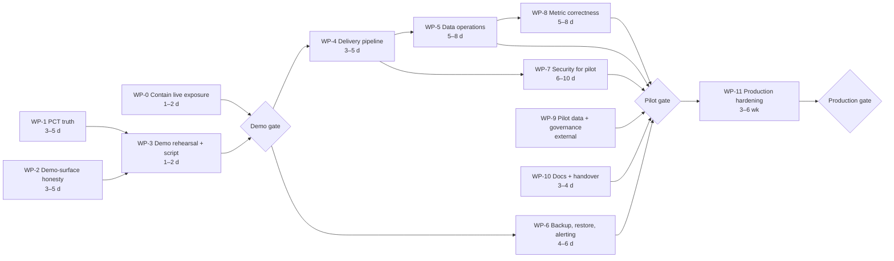

# D. Execution plan

Part of the [release-readiness pack](README.md). Every work package (WP) closes named findings from the
[findings register](03-findings-register.md) and has an evidence-based definition of done. Packages are bounded: each
one fits in a single reviewable PR or a short series of them, and none mixes unrelated changes.

## 1. Shape of the plan

**Critical path to a demo.** WP-0 (same day) ∥ [WP-1 → WP-3]. WP-2 runs alongside WP-1. Elapsed time is **about
1.5–2 weeks with two engineers**; the effort total for WP-0 to WP-3 is about 8–14 engineer-days. WP-1 is the long pole
because it includes a mart rebuild and a retrain.

**Critical path to a pilot.** Demo gate → WP-4 → WP-5 → WP-8, with WP-6 and WP-7 in parallel, plus the external WP-9.
That is **about 5–7 weeks after the demo gate with two engineers**, *if* the pilot data (RR-302) and the legal memo
(RR-303) arrive in time. Those two are the real critical path and should be requested now.

**Production.** WP-11 is roughly 3–6 weeks after the pilot gate, and the duration depends mostly on the decisions in §4.

**Parallelisable.**
- WP-0, WP-1 and WP-2 touch different components (gateway routes and identity; data and ML; UI widgets). WP-1 and
  WP-2 both rebuild images, so merge them into one release (WP-3).
- WP-6 is independent of everything except WP-4's tagging.
- WP-9 is external and should start immediately.

**Working agreement for every package.**
- Branch → PR → review → merge to `develop` → CI deploy (after WP-4; before that, a recorded manual deploy from a
  tagged commit).
- No push or merge without the reviewer's go-ahead.
- Each package ends with its completion evidence attached to the PR.

## 2. Packages before the demo gate

### WP-0 Contain the live exposure (do first, same day)
- **Findings:** RR-001, RR-207, RR-201, RR-404 (redaction only).
- **Scope:** gateway route guards, gateway ingress paths, Keycloak seed password, one doc redaction. Nothing else.
- **Components:** `6_access-points/api/nhdw-gateway/app/routes/audit.py` (and the routers listed in RR-207),
  `app/auth.py`, Helm `templates/gateway.yaml` / ingress, `7_security/keycloak/scripts/setup-keycloak.py`, the seed
  secret, `docs/production-readiness-assessment.md:286`.
- **Prerequisites:** the platform owner agrees a short maintenance window for the Keycloak reseed.
- **Steps:**
  1. Add `require_cap(user, "admin.audit.read")` to `/api/audit/events`.
  2. Add a shared `require_authenticated` dependency that rejects `R-PUB-ANON`, applied to every router outside the
     public allow-list.
  3. Restrict `ing-gateway` to `/api/public/`, `/api/profile`, `/api/permissions/dashboard/public`,
     `/api/permissions/widget/pub-`, `/health`, and the public widget-data paths. The dashboards keep using their
     `/gw` proxies.
  4. Set `docs_url=None, openapi_url=None` unless `ENV=dev`.
  5. Generate a random seed password per deployment, and make the seed fail if it is unset. Remove the literal from
     code and docs; tests read it from the environment.
  6. Enable brute-force protection on `moh-staff`.
  7. Reseed **with `PUBLIC_HOST_BASE` and every `DASH_BASE_*` set to the live host**, then dump every client's redirect
     URIs and verify that none contains `127.0.0.1` or `localhost`. A reseed without them breaks every SSO login.
  8. Query `gateway_log` for anonymous reads of the audit route, and hand the result to the data owner.
- **Tests:**
  - A new pytest that lists every route from `app.routes` and asserts anonymous → 401/403 except the allow-list.
  - The existing masking and OPA suites.
- **Acceptance:**
  - From outside the VM, the listed endpoints return 401/403/404.
  - SSO login works to internal-bi, admin, OpenMetadata, MLflow, dbt-docs, Airflow and Superset (headless login
    script).
  - `git grep` finds no password literal.
- **Rollback:** revert the gateway image to the previous digest (from WP-1 onward, digests are recorded). The Keycloak
  realm export taken before the reseed is restored with `kc.sh import`.
- **Completion evidence:** the curl matrix, the redirect-URI dump, the SSO login log, and the PR with the new test.

### WP-1 PCT truth: correct data, honest forecast basis, the commit you see is the commit you reviewed
- **Findings:** RR-002, RR-003, RR-004, RR-005, RR-022, plus the decision-integrity minimum from RR-018 (stale-verdict
  marker and visible failure only).
- **Scope:**
  - eLMIS current-context marts.
  - The forecast promotion gate and the AMC fallback.
  - The profile decision for the demo.
  - Rebuild all custom images from one tagged commit.
  - Disable the unregistered `stockout_forecast`.
- **Components:**
  - `2_pipelines/vault`, `2_pipelines/marts/models/{elmis_hist,pct,ct}`.
  - `bundle/seed-pack/app/ml/elmis_consumption_forecast`, `2_pipelines/ml/runner` (`runner.py`, `mlflow_io.py`,
    `train.py`).
  - `ops_ml.model_deployment`.
  - The profile files (both ACTIVE pointers).
  - All `nhdw/*` images.
- **Prerequisites (in this order):**
  1. **The CI runner checkout's uncommitted changes are committed or explicitly discarded by their owner.** It holds
     the only copy of the eLMIS synthesizer, and any CI run wipes it. Do not trigger CI before this is done.
  2. The product decision on the demo profile (§4, decision D1).
  3. A scratch copy of the vault DB for the rehearsal. The September rehearsal used one; it is currently stopped.
- **Steps:**
  1. Rebase `fix/abeni-elmis-current-context` (`c83f0f9`) onto `develop` and open the PR.
  2. In the same PR series:
     - change the runner so the default alias is none;
     - promote only when `champion_rule_passed == 1` (unit test);
     - when the rule fails, the position mart plans on `elmis_amc_not_champion`.
  3. Rehearse on the scratch DB: rebuild vault → marts; retrain; apply the gate. Record source Σ = mart Σ, position
     ΣSOH, plan units (expect ≈2.78M on AMC if the rule fails) and the planning-basis split.
  4. Disable `stockout_forecast` in `ops_ml.model_deployment` (via the seed, not a hand edit) and set pod cleanup on
     the ML DAGs.
  5. Implement decision D1. Make one ACTIVE pointer authoritative, and gate `/api/ct/plan` by the catalogue switch.
  6. Tag the merge commit, then build every custom image tagged by SHA with the `org.opencontainers.image.revision`
     label. Deploy, and record the digest ↔ SHA table in a ConfigMap shown by `/health`.
  7. Live rollout as **one sequence**: marts fix + forecast state together. Never the mart fix alone; it grows the plan
     from 11.1M to 17.7M units.
  8. Run one approve and one revert as a designated test user. They leave 2 rows by design, and the run needs the
     owner's written go-ahead. Alternatively, run them on the scratch copy only and record the live write test as
     waived.
- **Tests:**
  - dbt `elmis_lines_counted_once`.
  - A new singular test: mart Σ dispensed = landing Σ.
  - A promotion-gate unit test.
  - The contract test (`tests/test_pct_forecast_contract.py`) in CI.
  - The headless walk of the Control Tower.
- **Acceptance:**
  - Source Σ = mart Σ exactly.
  - 100% of position rows are AMC-based while the rule fails, or the forecast basis with a passing rule logged on a
    de-duplicated run.
  - Every `/app/**/*.py` and bundle in the running pods traces to the tag.
  - The Control Tower is reachable by the demo roles in the demo profile.
  - 0 failed ML pods for 3 nights.
- **Rollback:**
  - The previous digests are recorded in step 6.
  - Restore the marts with `dbt build` at the previous tag.
  - Restore the champion alias from the MLflow registry history. Alias changes are reversible.
- **Completion evidence:** the reconciliation table (before/after), the MLflow run id and model card, the digest ↔ SHA
  table, and the walk screenshots.

### WP-2 Demo-surface honesty
- **Findings:** RR-006, RR-007, RR-008, RR-010, RR-011, RR-012, RR-013 (brief line only), RR-014d/e, RR-015, RR-017,
  RR-021, RR-025, RR-026, RR-104, RR-301 ("source not connected" labels only), and RR-009 step (a): relabel only.
- **Scope:** UI widgets, two gateway fetchers, the profile copy deck, one marts build. **Not** metric re-engineering
  (that is WP-8).
- **Components:** `6_access-points/dashboards/public/ui/src/{hooks,widgets,data}`, `dashboards/public/app/main.py`,
  `dashboards/internal-bi/ui/src/{widgets,runtime,ct}`, `nhdw-gateway/app/fetchers.py`, the profile copy decks (in git
  after RR-011), and the `bi_quality` marts.
- **Prerequisites:** decision D2 (which pages are in the demo); D1 for the Control Tower banner wording.
- **Steps:**
  1. Delete every fabricated fallback: `KPIS_FALLBACK`, profile `fallback_kpis`, `charts.ts` bars and `Math.random`,
     `DATASETS`, the `ARTICLES` fallback, `ov-benchmarks` `DEFAULTS`, `ov-outbreak-hero`, `/api/series`, and the static
     plan import (`import type`). Replace them with an explicit unavailable state.
  2. Remove the seeded newsroom rows, or watermark them "Sample content" (decision D3).
  3. Publish the open-data manifest, or show the empty state.
  4. Fix the copy-deck placeholders and commit the live profile.
  5. Build `mart_data_quality` (and `mart_public_data_quality`) in a controlled refresh.
  6. Show NULL as "—", and drop counts computed over an empty base (RR-010), starting with the widgets on the demo
     path.
  7. Relabel `coverage_pct` consumers as "reporting rate" (RR-009a), and fix the "this week" and donut labels
     (RR-014d/e).
  8. Show region count, facility count and data month on the public tiles, and remove "all 14 regions".
  9. Add the provenance ribbon and per-widget as-of chip, and the Control Tower banner "Data as of Aug 2018 · plan for
     Sep 2018 · synthetic eLMIS archive".
  10. Rename "Optimized routes" and state the baseline. Show model probabilities as bands capped at "≥95%".
  11. Switch the profile and reference fetches to `authFetch` (RR-025).
  12. Read every title, footer and brand string from the profile; hide unconfigured IdPs (RR-026).
  13. Label lanes that are out of the demo scope "Source not connected" (RR-301, decision D2).
- **Tests:**
  - Component tests with a failing or empty fetch (no numeric output).
  - A CI grep guard over source *and built bundles* for `Math.random`, `FALLBACK`, `DEFAULTS` numerics, `EPSS`,
    `Ayder` and `{…}` placeholders in profile copy.
  - The `tsc` build for the public and internal-bi UIs.
- **Acceptance:**
  - With the gateway blocked, the public page shows no number.
  - Every demo page shows provenance and as-of.
  - The Disease map renders.
  - The grep guard is green.
- **Rollback:** revert the UI images to the WP-1 digests. The marts build is additive.
- **Completion evidence:** before/after screenshots per page, the guard output, and the fault-injection test log.

### WP-3 Demo rehearsal, script and limitations sheet
- **Findings:** RR-401, RR-406, RR-407, and the demo-gate criteria in the
  [acceptance criteria](06-standards-and-acceptance-criteria.md) §2.1.
- **Steps:**
  1. Flag every non-citable accuracy figure (RR-401), and regenerate the model card from MLflow after WP-1.
  2. Update the [demo script](05-demo-and-operations-handover.md) with the post-WP-1/2 figures, measured live.
  3. Two consecutive dry runs by two different people, with a diff of 5 named KPIs (D-DT2).
  4. Run axe-core on the demo pages. Fix serious and critical issues on the demo path, or record them as known
     limitations.
  5. Record a fallback video.
  6. Take a backup and restore it into a scratch DB (the minimum of D-RO2; the full version is WP-6).
- **Acceptance:** every criterion D-DT1 … D-DS2 has an evidence line. Any criterion that cannot be met is recorded as
  a signed known limitation, not silently passed.

**Demo gate = WP-0 to WP-3 complete, or each open item signed off as a disclosed limitation by the product owner.**

## 3. Packages for the pilot and production gates

### WP-4 Delivery pipeline you can trust
- **Findings:** RR-206, RR-004 (durable), RR-209, RR-211 (scanners only), RR-408.
- **Steps:**
  1. Make deploy depend on tests (`needs:` or `workflow_run`), and make the verify step fatal.
  2. Add `tsc` for all four UIs, `dbt parse` for the three projects, Trivy/Grype image scanning and pip-audit/npm audit.
  3. Use a clean `actions/checkout` on the runner, and parameterise the hard-coded host and kubeconfig paths in
     `deploy.yml`.
  4. Tag images by SHA everywhere, and keep the previous release's images.
  5. Split init SQL into boot seeds and forward-only migrations. Add a CI guard against destructive statements and a
     double-replay test on a scratch DB.
  6. Write a rollback runbook and rehearse it once.
  7. Export the branch-protection rules (required checks plus review on `develop` and `main`), and fast-forward `main`
     to the first tagged release.
- **Acceptance:**
  - A deliberately failing test blocks a deploy.
  - A push to `develop` deploys green.
  - A rollback to the previous tag is rehearsed with timings.
  - `main` points at a release tag.
- **Rollback:** CI changes are configuration; revert the PR.

### WP-5 Data operations
- **Findings:** RR-020, RR-101, RR-019, RR-301 (in-scope lanes), RR-024, RR-022 (permanent fix), RR-023, RR-107 (if in
  scope).
- **Steps:**
  1. Fix the `pipeline_refresh` KPO commands, args and env, and add per-stage row-count assertions.
  2. Make it data-driven: ingest → staging → vault → marts → publish → ML predict → marts.
  3. Add a freshness SLA per lane: dbt source freshness plus the DQ detector, alerting through WP-6.
  4. Publish the dbt artifacts for lineage, fix the OM FQN mapping, make lineage failure fail the DAG, and fix the OM
     probes.
  5. Run each in-scope missing lane under observation and keep the logs. Label out-of-scope lanes "Source not
     connected".
  6. Reseed the docs bucket, and add the docs-diff CI guard.
  7. Fix the 500s on `/api/exports/me` and `/api/reports/templates` (RR-023).
- **Acceptance:**
  - 7 consecutive green nightly runs.
  - Mart predict-run is under 24 h old.
  - The OM lineage walk covers every exposure-bound widget.
  - Each in-scope lane reconciles source → mart.

### WP-6 Backup, restore and alerting
- **Findings:** RR-102, RR-103, RR-210.
- **Steps:**
  1. A scheduled `pg_dump` (all DBs), a Keycloak realm export and a SeaweedFS bucket mirror to an off-VM target, with
     retention.
  2. Write RPO/RTO into `docs/deployment.md`.
  3. A timed restore drill into a scratch namespace or VM.
  4. A real Alertmanager receiver, plus node-exporter, kube-state-metrics and postgres-exporter, and rules for disk,
     crash-loops, DB down, cert expiry, backup age, gateway 5xx (correct metric name), freshness breach and DAG
     failure.
  5. Fix the 3 down scrape targets.
  6. Requests and limits on stateful pods; probe timeouts; pod TTLs.
- **Acceptance:**
  - 7 consecutive off-VM backups.
  - The restore drill meets the RTO and reproduces the decision, audit and mart counts.
  - Every alert has been fired once and received by a named person.

### WP-7 Security for the pilot
- **Findings:** RR-202, RR-203, RR-204, RR-205, RR-105, RR-018 (complete), RR-212, RR-214, RR-027, RR-028.
- **Steps:**
  - Kubeconfig mode 600 and per-user RBAC.
  - Default-deny NetworkPolicies.
  - Trino authentication and access control.
  - Revoke `bi_reader` on `bi_staging` and landing.
  - Rotate `fhir_writer`.
  - A real certificate, an HTTP→HTTPS redirect and a security-headers middleware.
  - Production-mode Keycloak, `sslRequired: external`, OTP for privileged roles, `/admin` restricted.
  - Rate and size limits.
  - Decision-log immutability: grants, a trigger, in-transaction audit, logged denials.
  - Bring the console under the chart (or remove it), and bind the replicas to localhost.
  - Role checks on the MLflow gate and Superset role mapping (RR-214).
  - Programme scope and pagination on `/api/ct/plan` (RR-027).
  - The R-SUPER classification grant (RR-028).
  - An ASVS 5.0 L1 self-assessment.
- **Acceptance:**
  - The P-SP1 … P-SP4 criteria.
  - The persona authorisation test suite: a viewer cannot decide, a region user cannot read another region, a
    notebook user is denied restricted marts.
  - An external port scan shows only 443 (and 22 from admin IPs).
- **Rollback:**
  - NetworkPolicies are applied namespace by namespace, with the allow rules tested on a scratch namespace first.
  - The Keycloak realm export is taken before each change.

### WP-8 Metric correctness
- **Findings:** RR-009 (full), RR-013, RR-014, RR-016, RR-109, RR-111, RR-112, RR-113, RR-501.
- **Steps:**
  1. A metric dictionary (one definition per KPI name, with grain, numerator and denominator), generated into the docs
     and checked in CI.
  2. True coverage indicators.
  3. Programme resolution.
  4. Distinct-facility counts.
  5. Typed widget states (ok/empty/denied/error/stale).
  6. The EFY calendar utility.
  7. Inventory reconciliation in CI.
  8. URL routing with deep-link preservation through login (RR-112), and a responsive layout (RR-113).
  9. A WCAG 2.2 AA pass on the pilot pages.
- **Acceptance:**
  - Widgets with the same label return the same value.
  - Every widget's number equals its mart equals an independent SQL recompute (scripted, per page).
  - 0 serious or critical axe findings.

### WP-9 Pilot data and governance (external; start now)
- **Findings:** RR-302, RR-303, RR-107.
- **Steps:**
  - Agree the pilot dataset and its refresh path with the data owner.
  - Commit or retire the eLMIS synthesizer.
  - Obtain the MFL.
  - The data-protection applicability memo.
  - The small-cell threshold sign-off.
  - Decide MDM and terminology scope.
- **Acceptance:** signed memo and threshold, documented pilot data provenance, MFL cross-check percentage reported.

### WP-10 Documentation and handover
- **Findings:** RR-402, RR-403, RR-405, RR-409, RR-410, RR-404 (banner).
- **Steps:**
  - Rewrite README, architecture and deployment to the as-built system.
  - A "current posture" section in `security.md`.
  - Move the hand-off prompts out of the tree; scrub traces and private paths; add a CI guard.
  - Generated dictionaries.
  - Changelog and decision addenda.
  - A complete docs index.
  - A link check in CI.
- **Acceptance:** a non-author brings the system up and runs the demo from the docs alone, and the CI guards are
  green.

### WP-11 Production hardening (after the pilot gate)
- **Findings:** RR-208, RR-213, RR-215, RR-108, RR-110, RR-106, RR-502, RR-211 (upgrades), plus the production criteria in §2.3
  of the acceptance criteria.
- **Content:**
  - JWT pinning and library upgrade; impersonation off.
  - Audit IP trust and retention.
  - A backfill and schema-contract strategy.
  - Profile-driven Control Tower.
  - The downstream decision (orders/export, or "decision log only").
  - i18n if required.
  - Component upgrades.
  - SLOs with error budgets.
  - A penetration test.
  - Pod Security Admission.
  - SLSA Build L2 provenance.
  - The single-node risk acceptance, or HA funding.
  - A support model.

## 4. Decisions needed (outside the engineering team's authority)

| ID | Decision | Why it matters | Options | Needed by |
|---|---|---|---|---|
| D1 | Which profile does the demo run, and what may the Control Tower claim? | The live profile hides the Control Tower (RR-005); PCT data is a synthetic Zambian 2017–18 archive | (a) `zm-v1`; (b) Palladium profile with the Control Tower enabled and an "archive replay" banner | Start of WP-1 |
| D2 | Which pages are in the demo scope? | The Resource page is empty (RR-301); the Service page's coverage semantics are wrong until WP-8 | Keep with "source not connected" labels / drop from the script | Start of WP-2 |
| D3 | The newsroom and open-data pages | They are seeded mock content attributed to real institutions (RR-008) | Remove / watermark "Sample content" / replace with approved content | Start of WP-2 |
| D4 | Planning basis while the forecast fails its rule | The contract says AMC; the live plan uses the forecast (RR-003) | Accept AMC for the demo (recommended) / delay the demo until a passing retrain | Start of WP-1 |
| D5 | Treatment of the audit-log exposure (RR-001) | Personal data of staff was publicly readable | Notify the data owner (recommended) / record internally | WP-0 |
| D6 | Pilot dataset, data owner, legal applicability, small-cell threshold | No real data and no legal basis yet (RR-302, RR-303) | — | Now (long lead) |
| D7 | Production availability target and single-node acceptance | It decides whether HA is in scope | 99.5% on one VM with a tested restore (recommended) / fund HA | Before WP-11 |
| D8 | Downstream use of approved plans | Approvals are terminal today (RR-106) | "Decision log only" / an export / eLMIS-QAT integration | Before the pilot UAT |
| D9 | Live write test of approve/revert | It leaves 2 audited rows in the live log | Approve on a test user / scratch-only | WP-1 step 8 |

## 5. Explicit deferrals

These are **not** planned before production unless a decision in §4 changes it:
- multi-node HA;
- a service mesh;
- SLSA Build L3;
- ISO 27001;
- a SIEM;
- PDBs on single-replica workloads;
- the OpenBao rollout (plain k8s Secrets with encryption at rest is the proportionate step);
- GitOps (ArgoCD is not installed);
- Grafana;
- route optimisation with vehicles, cost or capacity (the current sweep ordering is labelled honestly instead).

The rationale is in §0 and §3 of the [standards framework](06-standards-and-acceptance-criteria.md).
